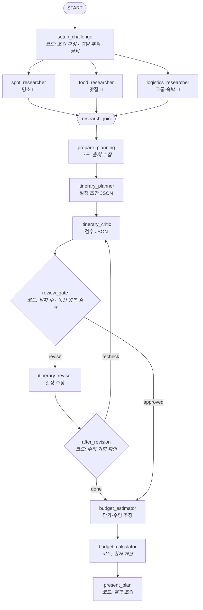
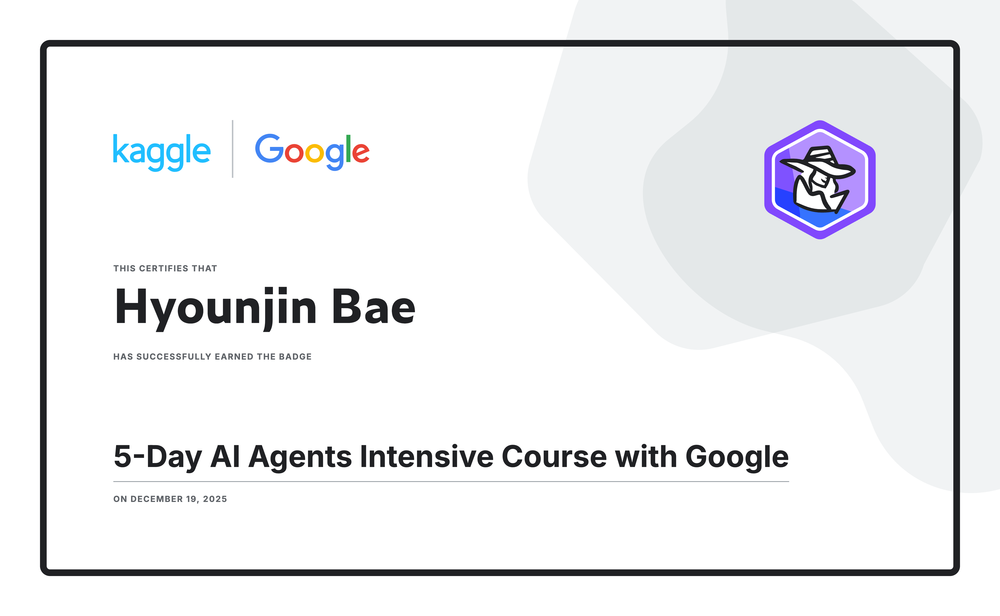

# 🎲 랜덤 여행 챌린지 (Random Trip Challenge)

**기간만 고르세요. 어디로 갈지는 룰렛이 정합니다.**

`당일치기` · `1박 2일` · `2박 3일` … 기간을 고르면 출발지에서 현실적으로 다녀올 수 있는 국내 여행지 한 곳을 무작위로 뽑고, AI 에이전트들이 실시간 검색으로 명소·맛집·교통을 조사해 **시간대별 일정**과 **항목별 예산**까지 만들어 줍니다.

Google **ADK 2.x Workflow**(그래프 기반 오케스트레이션)와 Gemini, Google 검색 그라운딩으로 만들었습니다.

> 이 저장소는 [Kaggle × Google 5-Day AI Agents Intensive (2025)](legacy/) 캡스톤 프로젝트였던 *Travel Concierge Multi-Agent System*을 실서비스 형태로 다시 설계한 버전입니다. 원본 코드는 [`legacy/`](legacy/)에 남겨 두었습니다.

---

## ✨ 주요 기능

| | |
|---|---|
| 🎲 **진짜 랜덤 추첨** | 추첨은 LLM이 아니라 코드가 합니다. 출발지와의 거리·기간·섬 접근성(제주 항공, 울릉도 배편)을 따져 갈 수 있는 곳만 후보로 남기고 가중치 랜덤으로 뽑습니다. |
| 🔎 **병렬 리서치** | 명소 / 맛집 / 교통·숙박 리서처 3명이 **동시에** Google 검색을 하고, 출처 링크를 모아 보여 줍니다. |
| 🧐 **검수 루프** | 일정 작성 → AI 검수자가 동선·식사·이동 시간을 점검 → 문제가 있으면 수정 에이전트가 고칩니다. 일차 수 같은 필수 조건은 코드로 한 번 더 검사합니다. |
| 💰 **정확한 예산** | LLM은 항목별 **단가와 수량만** 추정하고, 합계·예비비(10%)·1인당 금액은 파이썬이 계산합니다. 암산 실수가 없습니다. |
| 🌦️ **날씨 반영** | 출발일이 2주 이내면 [Open-Meteo](https://open-meteo.com/) 예보를 가져와 비 오는 날은 실내 일정을 늘립니다. |
| 🔁 **다시 돌리기** | 마음에 안 들면 이번 여행지를 빼고 다시 추첨합니다. |
| 🔗 **공유 링크** | 결과는 세션 DB에 저장되어 `?id=...` 링크로 다시 볼 수 있습니다. |

---

## 🧠 아키텍처

ADK 2.x에서 `SequentialAgent` / `ParallelAgent` / `LoopAgent`가 **`Workflow`** 로 대체되면서, 파이프라인 전체를 하나의 그래프로 선언합니다. LLM 노드와 일반 파이썬 함수 노드가 섞여 있고, 병렬 분기(fan-out)·합류(JoinNode)·조건부 라우팅·사이클(검수 루프)을 모두 씁니다.



### 설계 원칙

- **LLM이 잘하는 일만 LLM에게** — 추첨, 합산, 필수 조건 검사, 결과 조립은 결정적인 코드로. 검색·요약·일정 구성·검수는 LLM으로.
- **구조화 출력** — 일정·검수·예산은 모두 Pydantic `output_schema`로 JSON을 받아 UI가 그대로 렌더링합니다.
- **명시적 컨텍스트** — 모든 LLM 노드는 `include_contents="none"`으로 대화 기록을 받지 않고, Instruction Provider 함수가 세션 state에서 필요한 정보만 골라 프롬프트를 만듭니다.
- **동선은 코드로 검사** — LLM 검수자는 "남부 → 시내 → 남서부 → 시내" 같은 왕복 동선을 자주 놓칩니다. 플래너가 활동마다 권역(`area`)을 적고, 코드가 일자별 권역 순서를 뽑아 왕복을 찾아냅니다([`routes.py`](travel_roulette/routes.py)). 결과는 게이트 판정과 검수 프롬프트에 함께 쓰입니다.
- **토큰 다이어트** — 검색 요약·검수·수정·단가 추정은 `thinking_level=low`, 품질이 중요한 일정 작성만 기본 사고 수준. 수정 기회를 다 쓴 뒤에는 결과가 무시될 재검수를 건너뜁니다.
- **실패에 관대하게** — 날씨 API가 실패하면 계절 정보로 대체, 검수는 최대 수정 횟수 후 그대로 진행, 동시 실행 수는 세마포어로 제한합니다.
- **검색 할당량 대비** — Google 검색 그라운딩은 일반 호출과 할당량이 따로라 먼저 바닥날 수 있습니다. 429가 나면 리서처가 검색 없이 모델 지식으로 답하고(결과에 "검색 없이 작성" 표시), 이후 10분간은 검색을 건너뛰어 매 요청이 재시도로 시간을 버리지 않게 합니다.

---

## 🚀 빠르게 실행하기

Python 3.11 이상이 필요합니다.

```bash
python -m venv .venv && source .venv/bin/activate
pip install -r requirements.txt
cp .env.example .env   # GOOGLE_API_KEY 입력
```

### 1) 웹 서비스

```bash
uvicorn server.main:app --reload
```

http://localhost:8000 에서 기간을 고르고 **🎲 룰렛 돌리기**.

### 2) ADK 개발 UI (에이전트 디버깅용)

```bash
adk web .
```

`travel_roulette`를 고르고 채팅으로 요청합니다. 그래프 실행 과정과 각 노드의 state를 볼 수 있습니다.

```
2박 3일 부산에서 둘이 알뜰하게
```
```
다시
```

채팅 메시지에서 기간(`당일치기`, `2박 3일`, `이박삼일`, `3일 일정`), 출발지(`대구에서`), 인원(`4명`, `혼자`, `커플`), 예산(`가성비`, `호캉스`), 날짜(`11월 20일`, `내일`)를 알아듣습니다. 생략한 값은 이전 요청이나 기본값(서울 출발 · 1박 2일 · 2명 · 보통)을 씁니다.

---

## 🔌 API

| 메서드 | 경로 | 설명 |
|---|---|---|
| `GET` | `/api/meta` | 기간·출발지·예산 스타일 선택지와 여행지 목록 |
| `POST` | `/api/challenges` | 챌린지 실행. **Server-Sent Events**로 진행 상황을 스트리밍 |
| `GET` | `/api/challenges/{id}` | 저장된 결과 조회 |
| `GET` | `/healthz` | 헬스 체크 |

```bash
curl -N -X POST localhost:8000/api/challenges \
  -H 'Content-Type: application/json' \
  -d '{"nights": 1, "departure": "서울", "travelers": 2, "budget_level": "보통", "start_date": null, "exclude": []}'
```

스트림 이벤트 순서:

```
{"type":"session","id":"..."}
{"type":"stage","stage":"draw","label":"여행지 추첨"}
{"type":"challenge","challenge":{"destination":{"name":"강릉",...},...}}   ← 룰렛 결과가 먼저 도착
{"type":"stage","stage":"research",...}
{"type":"stage","stage":"plan",...} … {"type":"stage","stage":"done",...}
{"type":"result","id":"...","plan":{challenge, itinerary, budget, weather, sources, review}}
```

---

## ☁️ 배포 (Cloud Run 예시)

> 현재 공개 배포는 하지 않았습니다. 공개한다면 요청마다 API 비용이 들기 때문에 사용자별 요청 제한(rate limit)을 먼저 넣는 것을 권장합니다.

```bash
gcloud run deploy travel-roulette \
  --source . \
  --region asia-northeast3 \
  --set-env-vars GOOGLE_GENAI_USE_VERTEXAI=FALSE \
  --set-secrets GOOGLE_API_KEY=gemini-api-key:latest \
  --allow-unauthenticated
```

Cloud Run은 컨테이너 파일시스템이 휘발성이라, 공유 링크를 오래 유지하려면 `DATABASE_URL`을 Cloud SQL(PostgreSQL) 등으로 지정하세요. 로컬에서는 `docker build -t travel-roulette . && docker run -p 8080:8080 --env-file .env travel-roulette`로 확인할 수 있습니다.

---

## 🧪 테스트

API 키 없이 돌아갑니다. 테스트는 **가짜 LLM**([`tests/fake_llm.py`](tests/fake_llm.py))으로 그래프 전체를 끝까지 실행해 병렬 리서치, 검수 반려→수정 루프, 예산 계산, SSE 스트림, SQLite 세션 저장, 지표 수집, ADK 평가 파이프라인까지 검증합니다.

```bash
pip install -r requirements-dev.txt
pytest
```

---

## 📏 평가 (`adk eval`)

여행지가 매번 랜덤이라 "정답 문장과 얼마나 비슷한가"로는 채점할 수 없습니다. 그래서 두 가지 지표를 씁니다 ([`travel_roulette/evals/`](travel_roulette/evals/)).

| 지표 | 방식 | 기준 |
|---|---|---|
| `plan_structure_score` | **코드 채점** (커스텀 지표) | 일차 수 · 출발지 · 인원 · 매일 식사 · 예산 합계 · 한국어 — 6개 모두 통과 |
| `rubric_based_final_response_quality_v1` | **LLM 심사** (루브릭 6개, 3회 샘플링) | 일정 현실성 · 동선 · 도착/귀가 반영 · 구체적 장소 · 예산 타당성 · 자연스러운 한국어 — 0.8 이상 |

시나리오는 당일치기 / 1박 2일 부산 혼자 알뜰 / 2박 3일 대구 4명 여유 / 3박 4일 광주 / "이박삼일 커플" 5가지입니다. 실행에는 API 키가 필요하고, 1회 실행에 시나리오당 LLM 약 10회 + 심사 호출이 듭니다.

```bash
PYTHONPATH=. adk eval travel_roulette travel_roulette/evals/challenge.evalset.json \
  --config_file_path travel_roulette/evals/test_config.json \
  --print_detailed_results
```

`PYTHONPATH=.`가 없으면 커스텀 지표(`travel_roulette.evals.metrics`)를 import하지 못해 `plan_structure_score`가 `NOT_EVALUATED`로 나옵니다.

## 📊 관측성

[`RunMetricsPlugin`](travel_roulette/observability.py)이 실행마다 **에이전트별 LLM 호출 수·응답 시간·토큰**과 **노드별 완료 시점**을 모아 JSON 한 줄로 로그를 남깁니다. 서버는 동시에 여러 요청을 처리하므로 실행(invocation)별로 따로 집계합니다. 웹 결과 화면에도 "AI 호출 N회 · M초"가 표시됩니다.

로그 형식 (숫자는 예시):

```
INFO travel_roulette.metrics run_metrics {"duration_s": 41.3, "llm_calls": 8, "tokens": {"total": 52310, ...},
  "milestones": {"setup_challenge": 0.4, "research_join": 14.8, "itinerary_planner": 27.1, ...},
  "agents": {"spot_researcher": {"calls": 1, "seconds": 13.9, ...}, ...}}
```

모든 콜백을 콘솔에서 보고 싶으면 `TRAVEL_VERBOSE_LOGGING=1`로 ADK 기본 `LoggingPlugin`을 켭니다.

---

## 📈 성능 개선 기록

실제 Gemini(`gemini-3.5-flash`)로 `adk eval` 5개 시나리오를 돌려 측정했습니다. 품질은 LLM 루브릭 심사(6개 항목, 0.8 이상 통과)와 코드 채점(6개 조건)으로 봅니다.

| 버전 | 바꾼 것 | 평균 소요 | 평균 토큰 | 루브릭 | 코드 채점 |
|---|---|---|---|---|---|
| 초기 | 검색 할당량 소진 상태, 기본 사고 수준 | 135초 (1회) | 42k | – | – |
| 기준선 | 검색 복구, 리서치·검수·예산 `thinking=low` | 41.4초 | 25.4k | 0.96 (왕복 동선 1건 실패) | 1.00 |
| v2 | 권역 기반 동선 검사, 재검수 생략, 검수 입력 중복 제거, 리서치 출력 압축 | 47.4초* | 22.2k | 0.96 | 1.00 |
| **v3** | 출력 필드 축소, 수정 단계 `thinking=low`, 플래너 자가 점검 규칙 | **35.8초** | **18.9k** | **1.00 (5/5)** | **1.00** |

\* v2 평균은 수정이 발생한 3박 4일 케이스(86초) 하나가 끌어올렸습니다.

**어떻게 찾았나** — [`RunMetricsPlugin`](travel_roulette/observability.py)으로 에이전트별 시간을 재 보니 병목은 일정 작성(17~22초)과 수정(21초)이었고, 생성 속도가 초당 약 220토큰이라 **출력·사고 토큰을 줄이는 것 = 속도 개선**이었습니다. 같은 여행지로 비교하려고 평가 세트에 시드를 고정했습니다(대구→수원 2박 3일: 58초·31k → 36초·17k).

**주의** — 기준선·v2는 시드 고정 전이라 시나리오별 여행지가 v3와 다릅니다. 루브릭 심사는 토큰 절약을 위해 1회 샘플링이라 편차가 있을 수 있고, 심사 모델 응답 형식 오류로 채점이 빠진 케이스(기준선·v2 각 1건)는 평균에서 제외했습니다.

## 📁 구조

```
travel_roulette/          ADK 앱 패키지 (adk web이 인식)
├── agent.py              Workflow 그래프와 노드 정의 (root_agent, app)
├── destinations.py       국내 여행지 46곳 · 출발지 6곳 · 랜덤 추첨 로직
├── request_parser.py     채팅 메시지 → 여행 조건 파싱 (TripRequest)
├── prompts.py            에이전트 지시문 (Instruction Provider)
├── schemas.py            일정 · 검수 · 예산 구조화 출력 스키마
├── budget.py             예산 합계 계산
├── weather.py            Open-Meteo 날씨 예보
├── routes.py             일정 동선(권역 순서) 왕복 검사
├── render.py             채팅용 마크다운 렌더링
├── observability.py      실행별 지표 수집 플러그인
├── evals/                adk eval 평가 세트 · 설정 · 커스텀 지표
└── config.py             모델명 등 환경 설정
server/
├── main.py               FastAPI (SSE 스트리밍, 세션 DB)
└── static/               웹 UI (바닐라 JS, 다크 모드 지원)
tests/                    단위 · 워크플로 · 서버 테스트
legacy/                   Kaggle 캡스톤 원본 코드 (2025)
```

---

## 🔄 Kaggle 캡스톤 버전과 달라진 점

| | 2025 캡스톤 | 지금 |
|---|---|---|
| 콘셉트 | 도시를 직접 입력하는 여행 플래너 | 기간만 고르면 국내 여행지를 **랜덤 추첨** |
| 오케스트레이션 | 코디네이터 LLM이 `AgentTool`로 순서대로 호출 | ADK 2.x **Workflow 그래프** (병렬·조건 분기·루프) |
| 리서치 | 에이전트 1개 | 명소·맛집·교통 **3개 병렬** + 출처 수집 |
| 품질 관리 | 없음 | 검수 → 수정 루프 + 코드 기반 필수 조건 검사 |
| 예산 | LLM이 Code Executor로 계산 | LLM은 단가만, **합계는 파이썬** |
| 출력 | 자유 텍스트 | 구조화 JSON (Pydantic) |
| 관측성 | 노트북 출력 확인 | 실행별 지표 플러그인 (Day 4a 응용) |
| 평가 | 없음 | `adk eval` 코드 채점 + 루브릭 LLM 심사 (Day 4b 응용) |
| 실행 환경 | Colab 노트북 | 웹 서비스 + `adk web` + Docker |
| 언어 | 영어 | 한국어 |

## ⚠️ 한계

- AI가 만든 일정이라 영업시간·요금·휴무일은 방문 전에 확인이 필요합니다.
- 예산은 검색 결과와 가이드라인 기반 추정치입니다.
- 거리 판단은 직선거리 기준이라 실제 이동 시간과 다를 수 있습니다(교통 리서처가 실제 소요 시간을 조사해 보완합니다).

---


